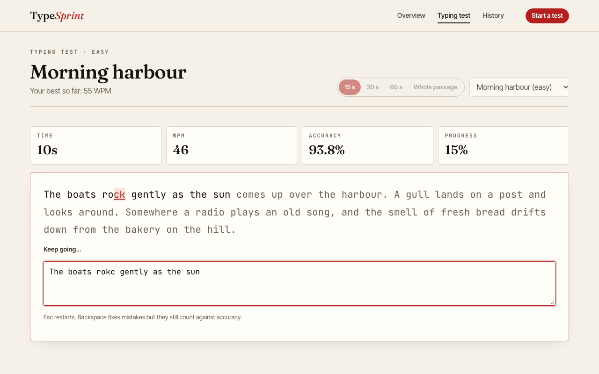
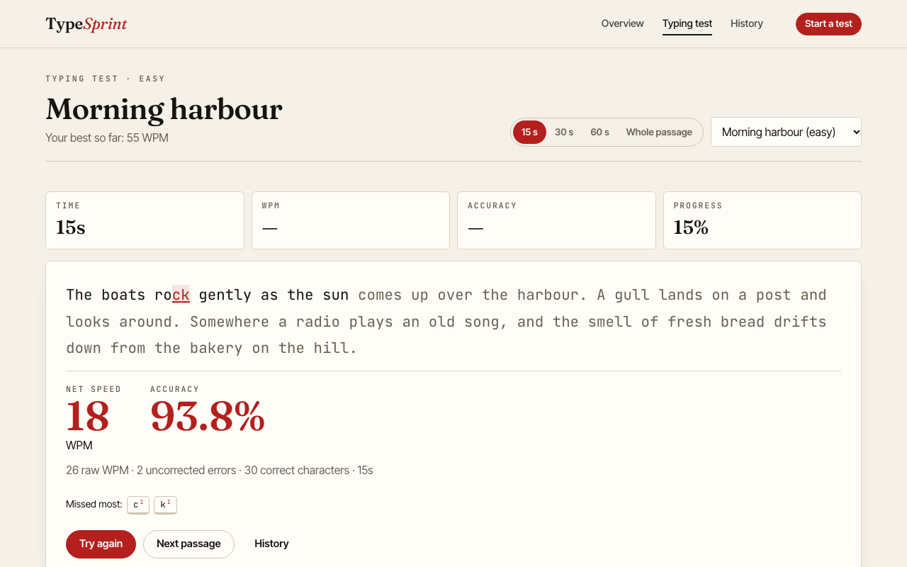
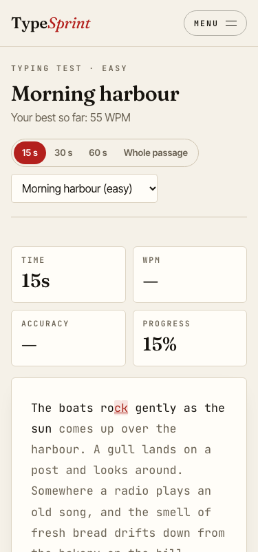

# TypeSprint

Timed typing practice with original passages, live speed and accuracy, in-place mistake highlighting, results with your most-missed keys, and a saved history with a progress chart.



| Result | Mobile |
| --- | --- |
|  |  |

## Run it

```bash
npm install
npm run dev        # http://localhost:5124
npm test
npm run build
npm run test:e2e   # Playwright smoke test (npm run e2e:install once if Chromium is missing)
```

## Main workflow

1. **Typing test** — choose 15 s, 30 s, 60 s or the whole passage, and one of six original passages (easy prose → hard text with numbers, symbols and accents).
2. Start typing; the timer starts on your first key. Wrong characters turn red in place (wrong spaces shown as ␣), a caret marks your position, and live time/WPM/accuracy/progress update. Esc restarts; pasting is blocked with a message.
3. The test ends when time runs out or the passage is finished. Results: net WPM, accuracy, raw WPM, uncorrected errors, correct characters, a personal-best note, and the keys you missed most.
4. **History** — personal best, last-10 average speed and accuracy, a WPM chart with tooltips, keys to practise across recent tests, and a table of all tests. Opens with labelled demo history.

## Scoring

- One word = 5 characters. Raw WPM = characters typed ÷ 5 ÷ minutes. Net WPM = raw − uncorrected errors per minute.
- Accuracy = correct keystrokes ÷ all character keystrokes (corrected mistakes still count against it).

## Tests

- `src/lib/typing.test.ts` — character states, raw/net WPM, accuracy, zero-time safety, missed-key tallies, history summary, passage set.
- `src/App.test.tsx` — whole-passage completion with a corrected mistake, timed test ending via fake timers, paste blocking, history and empty state.
- `e2e/smoke.spec.ts` — Playwright clock drives a real 15-second test with a typo, result, reload and history chart; strict 375px checks.

## Limitations

- Six built-in passages; no custom text yet.
- Desktop keyboards recommended; mobile autocorrect can distort results (autocorrect attributes are disabled where browsers allow).
- No per-finger or per-key timing analysis.

## Future improvements

- Custom passages, drills generated from your most-missed keys, and per-key speed heatmaps.
